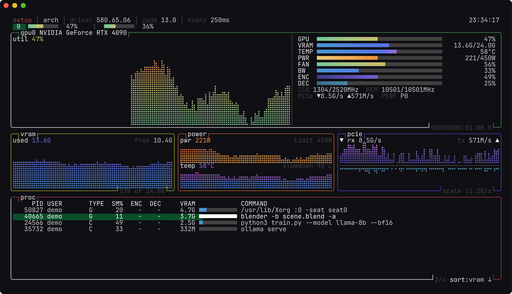

# nvtop

A [btop](https://github.com/aristocratos/btop)-inspired terminal monitor for NVIDIA GPUs, written in Go.

[](https://github.com/zvdy/nvtop/actions/workflows/ci.yml)
[](https://pkg.go.dev/github.com/zvdy/nvtop)
[](LICENSE)



## Features

- **Braille history graphs** for utilization, VRAM, power, temperature and PCIe throughput, with two samples per cell and gradient coloring
- **Live meters** for GPU, VRAM, temperature, power, fan, memory bandwidth, NVENC/NVDEC, clocks and performance state
- **Process table** showing per-process SM/encoder/decoder usage and VRAM. You can sort it, scroll it and send signals from it, and the selection stays on the same PID when rows reorder
- **Multi-GPU** support with an overview strip and quick switching
- **Four themes**: `default`, `nord`, `dracula` and `gruvbox`. You can switch themes while it runs
- **JSON output** (`-json`) for scripts and monitoring pipelines
- **Simulated backend** (`-mock N`) so you can try the UI without NVIDIA hardware
- Metrics a device doesn't support show as `n/a` and don't break the layout

## Install

You need Go 1.27+, a C toolchain (cgo) and the NVIDIA driver, which provides `libnvidia-ml.so`.

```sh
go install github.com/zvdy/nvtop/cmd/nvtop@latest
```

Or build from source:

```sh
git clone https://github.com/zvdy/nvtop && cd nvtop
make build        # ./bin/nvtop
make demo         # run against two simulated GPUs
```

NVML is loaded at runtime with `dlopen`, so the binary builds on machines without a GPU. Builds without cgo, or for platforms other than Linux, compile with a stub backend and can only use `-mock`.

## Usage

```
nvtop [flags]

  -i, -interval duration   refresh interval (default 1s)
  -theme string            color theme: default, dracula, gruvbox, nord
  -mock n                  simulate n GPUs instead of querying NVML
  -json                    print a single snapshot as JSON and exit
  -version                 print version and exit
```

```sh
nvtop -i 250ms -theme nord
nvtop -json | jq '.devices[] | {name, util, temp, power}'
```

### Keys

| Key                         | Action                              |
| --------------------------- | ----------------------------------- |
| `q`, `ctrl+c`               | quit                                |
| `?`                         | help                                |
| `tab` `→` `l` / `shift+tab` `←` `h` | next / previous GPU         |
| `0`–`9`                     | jump to GPU                         |
| `↑` `↓` `j` `k`, `pgup` `pgdn`, `g` `G` | move selection          |
| `s` / `r`                   | cycle sort column / reverse order   |
| `x`, `del`                  | signal process (`t` SIGTERM, `k` SIGKILL) |
| `+` / `-`                   | slower / faster refresh             |
| `space`, `p`                | pause                               |
| `t`                         | cycle theme                         |

## Architecture

```
cmd/nvtop            flag parsing, backend selection, JSON mode
internal/gpu         Source interface, Snapshot model
  nvml.go            NVML backend (linux && cgo)
  nvml_stub.go       fallback for other builds
  mock.go            deterministic simulated GPUs
  proc.go            /proc lookup with a PID cache
internal/history     generic fixed-size ring buffer
internal/ui          Bubble Tea model, layout and widgets
  widgets.go         braille graph, gradient meter, titled box
  procs.go           sortable process table with PID-stable selection
```

The UI depends only on the `gpu.Source` interface. Each sample is taken in a `tea.Cmd`, so a slow NVML call never blocks rendering, and the next tick is scheduled only after the current sample arrives, so samples never overlap.

## Development

```sh
make test     # go test -race ./...
make lint     # golangci-lint (config in .golangci.yml)
make cover
```

If a real GPU is present, the NVML integration test runs automatically. Otherwise it is skipped.

## License

[MIT](LICENSE)
